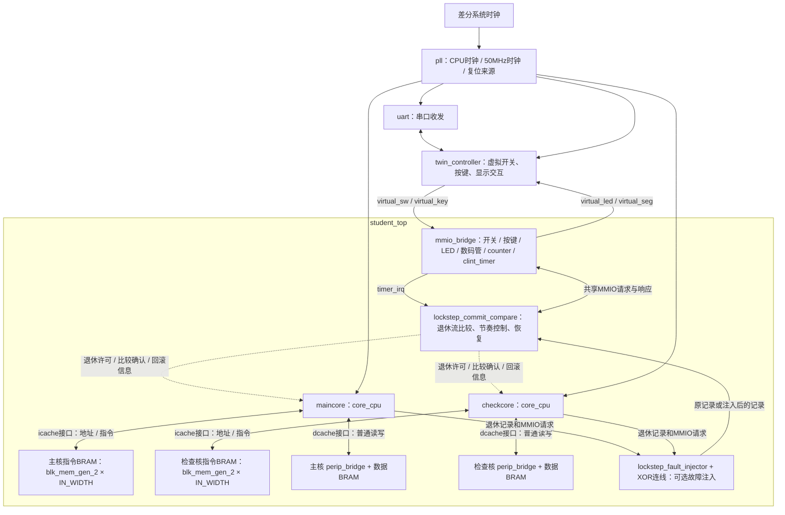
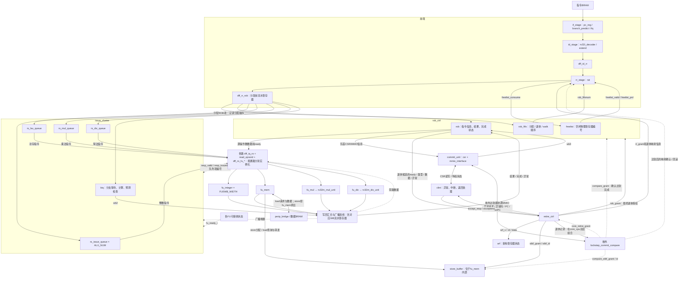
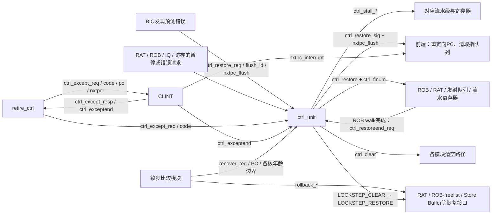
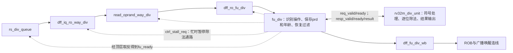

# 参考项目模块交互图

按 `D:/zz/superscalercore` 当前源码中的实例和端口连接绘制。描述参考项目的完整结构，不表示练习项目已经实现了全部模块。图中把重复通道、流水寄存器和同类信号合并；标为“连线”的节点不是额外 RTL 模块。

## 整机：top → student_top → 两个 core_cpu

- 两个核使用相同的 `core_cpu` 模块，独立执行，退休节奏由比较模块协调。
- 当前顶层的 `icache_busy` 和 `dcache_busy` 为常量 0；接口名叫 cache，并不代表这里实例化了完整 Cache 或 AXI 总线。
- `perip_bridge` 下接 `dram_driver` 和两个 `empty_dram_driver`，分别覆盖普通数据、异常向量及日志区域。
- `lockstep_commit_compare` 的定义位于 `vsrc/lockstep/compare_fifo.sv`，文件名和模块名不同。
- 故障注入器生成掩码，顶层 XOR 连线把掩码施加到两核输出。`top.sv` 默认把外部故障注入请求接成 0。

## 单个 core_cpu：指令、数据、写回与退休

- 各路 `read_oprand` 独立实例化，共享写回旁路输入；图中的合并节点不表示不同类型指令共用一个读操作数模块。
- BIQ 自己完成分支计算，通过 wb2 写回；当前前端名字为 rt_* 的分支训练端口，顶层实际接 BIQ 的 wb2 信息。
- `arf` 在当前模块中只有退休写接口；读操作数的数据路径来自 ROB 和写回旁路。
- 普通执行写回不等于退休；退休也不等于锁步比较确认。
- 核内退休先通知 Store Buffer；比较确认的存储授权还有单独的 `compare_stbf_grant`，不能把核内退休画成直接写外部内存。
- `commit_unit` 处理 CSR/MMIO；它不是所有普通整数指令都必须经过的最终退休级。
- 队列的就绪候选由 `age_matrix_arbiter` 选年龄最老者，各类队列自己的发射条件仍然生效。

## 控制：暂停、分支恢复、异常、锁步回滚

`ctrl_unit` 的 `ctrl_except_resp` 输出在顶层悬空；退休实际使用的同名信号由 CLINT 产生。

## 除法通路在整机中的位置

普通 restore 对 fu_div 保存的在途指令做年龄过滤，不直接 flush 内部除法器；ctrl_clear 才接到 rv32m_div_unit.flush_i。内部除法器普通操作执行 XLEN 轮，除零和有符号溢出走特殊结果路径。
